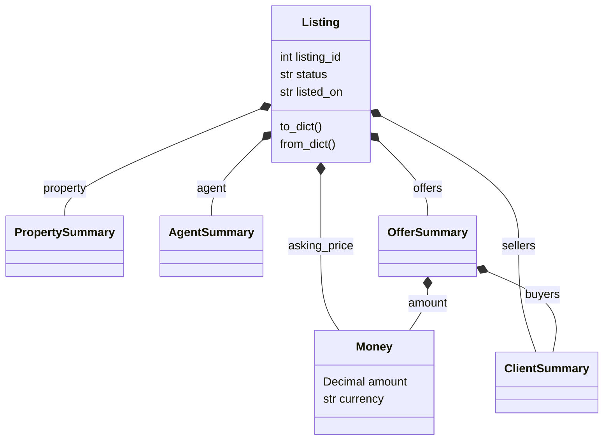

# Listing objects and PostgreSQL JSONB

`models.py` implements an actual Listing object hierarchy using Python dataclasses.
Composition connects a listing to a property summary, agent summary, seller array
and offer array; each offer has buyer summaries and a Money value object. Inheritance
is not forced onto unrelated Phase 1 entities. The same object is serialized to
JSON and stored in PostgreSQL `jsonb`, rather than maintaining unrelated examples.



The diagram describes composition of read-model values, not ownership or deletion
of the authoritative client/property/agent records. See `models.py` for all fields.

## Run

Use an existing seed database after SQL scripts 01-05, 07_views.sql and 08_stored_procedures.sql. Run `00_schema.sql` once to
create the separate `tre_oo` read-model schema. The original `tre` schema still has
exactly 11 business tables and 63 attributes.

```powershell
psql -X -h localhost -U postgres -d tre_phase2 -v ON_ERROR_STOP=1 -f '.\Phase2_Implementation\OO_JSONB_Mapping\00_schema.sql'
python '.\Phase2_Implementation\OO_JSONB_Mapping\build_and_validate.py' --host localhost --port 5432 --user postgres --database tre_phase2
```

Python uses only its standard library and `psql`; use your normal password prompt
or ignored local PGPASSFILE. If `psql` is not on PATH or installed at the Windows
PostgreSQL 18 default path, pass `--psql` explicitly.

The exporter reads real seed rows, constructs 250 Listing objects, verifies all
250 JSON round trips, generates `01_load_snapshots.sql`, loads 250 snapshots and
runs four queries. It also refreshes the NoSQL prototype's 20-showing reference capture in NoSQL_Prototype/sample_data.json. The generated load script is an explicit upsert refresh, so its current
contents can reproduce the captured seed without running Python. It does not
delete snapshots that no longer appear in a later export.

## Mapping and tradeoffs

| Object or relationship | JSON representation |
|---|---|
| Listing scalar fields | Root properties with schema_version 1 |
| PropertySummary and AgentSummary | Nested objects |
| Sellers and Offers | Arrays of objects |
| Offer buyers | Nested array |
| Money | CAD currency plus exact two-decimal amount string |

Money stays as `Decimal` in Python and a decimal string in JSON. Queries cast it
to `numeric`, avoiding binary floating-point rounding. JSONB has root, required-key,
matching-ID/version and nested-shape checks; the importer supplies full typed
structure validation. A GIN `jsonb_path_ops` index supports containment predicates.

This format is useful for a listing-details API or captured report because it
retrieves the whole hierarchy together. It duplicates summaries, may become stale
and cannot replace relational FKs, normalization, cross-table rules or live money
and state transactions. PostgreSQL `tre` remains authoritative; snapshots are
read models refreshed explicitly with `captured_at`. They are not updated by
Firestore or automatically synchronized with later SQL edits.

## Actual query results

| Query | Purpose | Actual rows | Example |
|---|---|---:|---|
| J01 | Read nested property/agent/price and array lengths | 1 | Listing 1, SOLD, CAD 283250.00, 2 sellers, 2 offers |
| J02 | Find ACTIVE CONDO listings using JSONB containment | 13 | Listing 102, TRE-P-0102, CAD 456500.00 |
| J03 | Expand and group seller arrays for joint sellers | 65 | Full results in `Results.json` under queries.J03 |
| J04 | Expand accepted offers inside the object array | 125 | Full results in `Results.json` under queries.J04 |

Sources are the J01-J04 sections in [JSONB_Queries.sql](JSONB_Queries.sql).
[Results.json](Results.json) contains every result row and the validation summary.
Validation found zero status/price/property/agent mismatches at capture and
rejected two malformed JSONB inputs. [listing_snapshots.json](listing_snapshots.json)
contains all 250 objects; its first object is the listing 1 example.

Reference: [PostgreSQL 18 JSON functions and operators](https://www.postgresql.org/docs/18/functions-json.html).
